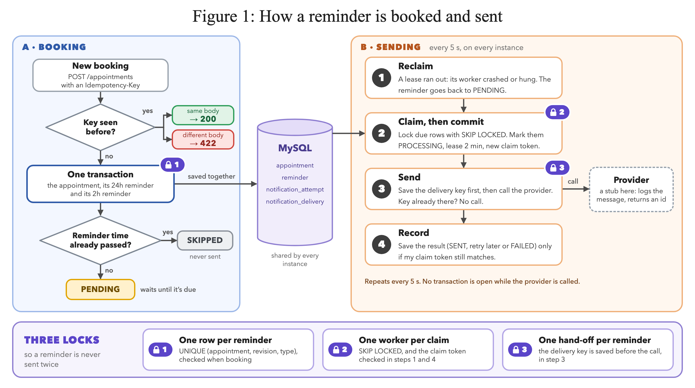
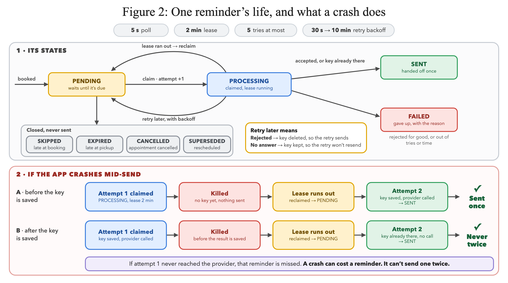
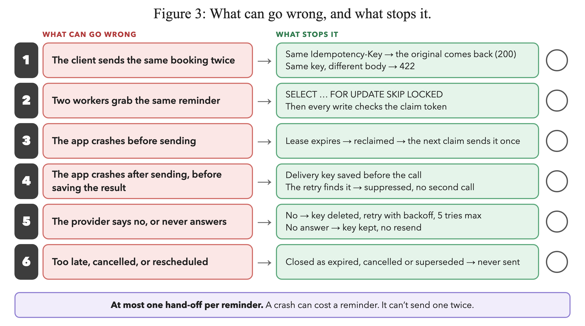

# Appointment Reminder Service

A Spring Boot service that books vehicle service appointments and reminds each customer **24 hours** and **2 hours** before the appointment. Messages go through a stub `NotificationSender` that logs the payload instead of sending it.

The design is built around one rule: **a customer must never receive the same reminder twice**, even when the service crashes in the middle of sending.

| | |
|---|---|
| Stack | Java 21 · Spring Boot 4.1 · Spring Data JPA · MySQL 8.4 · Flyway · Testcontainers |
| Run | `docker compose up --build`, then open http://localhost:8080 |
| Test | `./mvnw verify`: 29 unit tests and 71 integration tests against a real MySQL |
| Demo video | _Link to be added_ |

---

## The problem

The brief asks for:

- `POST /appointments` with a scheduled time and a customer contact
- a reminder 24 hours before the appointment, and another 2 hours before
- a stub sender that only logs the payload
- **never the same reminder twice**, provably, including when the service crashes before the send is acknowledged
- up to 50,000 appointments a day across 500 dealerships

## Why it is hard

The obvious design is an appointments table and a job that sends whatever is due, then marks it sent. That design sends duplicates in ordinary situations:

| What happens | Result in the obvious design |
|---|---|
| The client times out and retries the `POST` | Two appointments, so two sets of reminders |
| Two instances poll at the same moment | Both pick up the same reminder and both send it |
| The process crashes after calling the provider, before writing "sent" | The retry sends it again |
| The provider times out | Nobody knows whether the message went out |

The root issue is that the provider call is outside the database transaction. "Send" and "record that we sent" can't happen atomically, so one has to come first:

- **Send, then record.** A crash in between means the retry sends again. That breaks the rule.
- **Record, then send.** A crash in between means the reminder may never go out. That is a miss, not a duplicate.

The brief says "never twice", so this service records first, and every reminder that might have been missed stays visible in the database.

## The approach: three locks

Each kind of duplicate is stopped by a database constraint, not by application discipline.

| Lock | Mechanism | What it stops |
|---|---|---|
| 1. One row per reminder | `UNIQUE (appointment_id, appointment_revision, reminder_type)` | The same reminder being scheduled twice |
| 2. One worker per claim | `SELECT … FOR UPDATE SKIP LOCKED`, plus a claim token checked on every later write | Two workers sending the same reminder |
| 3. One hand-off per reminder | A `notification_delivery` row keyed by the reminder, inserted and committed **before** the provider is called | A retry sending again after a crash |

A client retrying `POST /appointments` is handled separately, by an optional `Idempotency-Key` header that is unique per dealership.

---

## How a reminder is booked and sent



**Booking (left).** `AppointmentService.create` saves the appointment and both reminders in one transaction, so an appointment never exists without its reminders. If a request repeats an `Idempotency-Key` with the same body, the service returns the original appointment (`200`). The same key with a different body returns `422`. A reminder whose time has already passed at booking is stored as `SKIPPED`.

**Sending (right).** Every instance runs the same four steps on a 5-second fixed delay. All state lives in MySQL, so instances don't need to coordinate and a restart loses nothing.

| Step | What happens | Code |
|---|---|---|
| 1. Reclaim | A `PROCESSING` row whose lease expired goes back to `PENDING`. The update only wins if the claim token still matches. | `ReminderWorker.reclaimExpiredLeases` |
| 2. Claim, then commit | Lock due rows with `SKIP LOCKED`, mark them `PROCESSING` with a new claim token and a 2-minute lease, and commit **before** sending | `ReminderWorker.claimDueBatch`, `ReminderRepository.lockDueBatch` |
| 3. Send | With no transaction open, insert the delivery key, then call the provider. If the key already exists, skip the call. | `IdempotentNotificationSender.send` |
| 4. Record | Write `SENT`, retry later, or `FAILED`, but only `WHERE id = ? AND claim_token = ? AND status = 'PROCESSING'` | `ReminderDeliveryService` |

No transaction is open during the provider call, so a slow provider never holds row locks or database connections.

## One reminder's life, and what a crash does



- **`SENT` means handed off once.** Either the stub accepted the message, or an earlier attempt had already handed it off. It does not mean the customer received it. That would need delivery webhooks from a real provider.
- **Every claim counts as an attempt**, including claims whose worker crashed. After 5 attempts the reminder is `FAILED`, and the provider is not called again.
- **A definite rejection** deletes the delivery key, so the retry really sends. **No answer** (a timeout or an exception) keeps the key, so the retry is suppressed instead of resending.
- **Retries** back off from 30 seconds, doubling up to 10 minutes, with ±20% jitter. They stop after 5 attempts or once the reminder's send window closes.

A crash **before** the key is saved means nothing went out: the lease expires and the next claim sends it once. A crash **after** the key is saved means the next claim finds the key and doesn't call the provider again.

The one gap is a crash after saving the key but before calling the provider: that reminder is missed. It stays `RESERVED` in `notification_delivery`, together with every other hand-off the provider never acknowledged, so the in-doubt list is one query:

```sql
SELECT idempotency_key, reminder_id, recorded_at
  FROM notification_delivery
 WHERE status = 'RESERVED' AND recorded_at < UTC_TIMESTAMP(6) - INTERVAL 2 MINUTE;
```

## What can go wrong, and what stops it



Other corner cases:

| Case | Behaviour |
|---|---|
| Booked less than 24 hours (or 2 hours) ahead | That reminder is `SKIPPED`; the appointment is still created |
| Service was down when a reminder was due | Sent late only inside its window: the 24h reminder until 18 hours before, the 2h reminder until 30 minutes before, never after the start. Otherwise `EXPIRED`. The two windows never overlap. |
| Cancel | The appointment and every `PENDING` reminder become `CANCELLED` in one transaction. A reminder already in flight is handed off at most once. |
| Reschedule | A new revision, so new reminders with new keys. Old pending ones become `SUPERSEDED`. |
| Two edits to the same appointment at once | Optimistic locking (`@Version`) returns `409` |
| Database down while saving the delivery key | The provider is not called; the reminder is retried |
| Database down while recording the outcome | Retried 3 times. Then the lease expires, the row is reclaimed, and the saved key prevents a resend. |
| Database down during `POST` | `503`, and nothing is half-saved |
| Daylight saving | "24 hours before" means 24 elapsed hours; every time is a UTC `Instant` |
| Message wording | Always an absolute date and time in UTC, never "tomorrow" |
| Phone numbers and emails in logs | Masked, e.g. `+9198******10` |

---

## Data model

Flyway owns the schema (`src/main/resources/db/migration`). Hibernate only validates it.

| Table | Role | Constraints that matter |
|---|---|---|
| `appointment` | The booking. `revision` goes up on every reschedule. | `UNIQUE (dealership_id, idempotency_key)`; `version` for optimistic locking; a phone number or email is required |
| `reminder` | One row per reminder, and also the work queue | `UNIQUE (appointment_id, appointment_revision, reminder_type)`; `UNIQUE (idempotency_key)`; `CHECK` that a claim token and lease exist exactly while `PROCESSING`; index on `(status, next_attempt_at)` for the poll |
| `notification_attempt` | Append-only log of every claim and its outcome, with the exact payload | `UNIQUE (reminder_id, attempt_no)` |
| `notification_delivery` | One row per reminder handed to the provider | Primary key is the reminder key; `RESERVED` until the provider returns a message id, then `ACCEPTED` |

The reminder key is `appt-{id}-r{revision}-{type}`, for example `appt-18-r1-REMINDER_24H`. It is derived, not random, so every retry of the same reminder produces the same key, and a reschedule produces a new one.

---

## Run it

You need Docker. JDK 21 is only needed to run the tests or to run the app outside Docker; `./mvnw` downloads Maven.

```bash
# Real offsets: 24 hours and 2 hours
docker compose up --build

# Demo profile: same code, but 24h becomes 2 minutes and 2h becomes 1 minute
SPRING_PROFILES_ACTIVE=demo docker compose up --build
```

Open http://localhost:8080 for the console. You can book, retry with the same key, cancel, reschedule, and watch each reminder change state next to the service log.

Or use curl. This books an appointment 3 minutes from now, for the demo profile. On Linux, replace the `date` call with `date -u -d '+3 minutes' +%Y-%m-%dT%H:%M:%SZ`.

```bash
curl -i -X POST localhost:8080/appointments \
  -H 'Content-Type: application/json' -H 'Idempotency-Key: demo-1' \
  -d '{"dealershipId":1,
       "customer":{"name":"Aarav Sharma","phone":"+919876543210","preferredChannel":"SMS"},
       "vehicle":"2023 Tata Nexon","serviceType":"Oil change",
       "scheduledAt":"'"$(date -u -v+3M +%Y-%m-%dT%H:%M:%SZ)"'"}'
```

`scripts/demo.sh` wraps the common steps:

```bash
scripts/demo.sh create 3     # book an appointment 3 minutes ahead
scripts/demo.sh replay       # same key and body again: 200 + Idempotent-Replayed
scripts/demo.sh logs         # appointment, reminder and notification log lines
scripts/demo.sh db           # appointment, reminder, attempt and delivery rows
scripts/demo.sh invariants   # the "never twice" checks; every count must be 0
scripts/demo.sh crash        # kill -9 the app mid-send, then restart it
```

For the crash demo, start with a slow stub so there is time to catch a send in progress:

```bash
NOTIFICATION_STUB_LATENCY=PT20S SPRING_PROFILES_ACTIVE=demo docker compose up --build -d
```

## API

| Endpoint | Behaviour |
|---|---|
| `POST /appointments` | `201` with the appointment and its two reminders. Optional `Idempotency-Key` header: the same key and body returns `200` with `Idempotent-Replayed: true`; the same key with a different body returns `422`. |
| `GET /appointments/{id}` | The appointment, plus each reminder's status, attempt count, sent time and provider message id |
| `POST /appointments/{id}/cancel` | Cancels the appointment and its pending reminders. Repeating it is a no-op. After the start time it returns `409`. |
| `PATCH /appointments/{id}` | `{"scheduledAt": …}` reschedules it as a new revision |
| `GET /appointments?limit=20` | Recent appointments, newest first |
| `GET /demo/logs` | Recent service log lines, for the console |

`scheduledAt` must be ISO-8601 with an offset, in the future, and at most 365 days ahead. Errors are returned as `application/problem+json`.

## Tests

```bash
./mvnw test      # 29 unit tests, no Docker needed
./mvnw verify    # plus 71 integration tests against MySQL 8.4 (Testcontainers)
```

| Suite | What it proves |
|---|---|
| `NoDuplicateGuaranteeIT` | Each crash point: after the claim, between saving the key and calling the provider, after the provider accepted. A worker that outlives its lease. 8 racing workers × 40 reminders, each sent exactly once. |
| `ClaimConcurrencyIT` | On real InnoDB locking, `SKIP LOCKED` gives concurrent claimers disjoint rows, and an expired lease is reclaimed exactly once by 8 racing instances |
| `ReminderWorkerIT` | Due timing, late windows, retries and giving up, rejections, unknown outcomes, cancel and reschedule while a send is in flight |
| `AppointmentApiIT` | Validation, idempotent replay, `422` on key reuse, 16 concurrent requests with the same key creating one appointment |
| Unit tests | Timing rules and daylight saving, backoff, message text, masking, request hashing, the console log buffer |

In tests the scheduler is off and the clock is fake, so each step is driven directly and nothing depends on timing. A fake provider sits behind the real `IdempotentNotificationSender`, so the sending protection itself is under test. Every integration test ends by checking three invariants: no reminder has two rows, every `SENT` reminder has a delivery record, and no reminder was accepted twice.

## Scale

50,000 appointments a day means about 100,000 reminders: about 1.2 per second on average, and about 22 per second if a fifth of them fall in one 15-minute morning window. Each reminder costs about six small SQL statements.

- The poll is a range scan on `(status, next_attempt_at)`, so its cost depends on how many reminders are due, not on the table size.
- `SKIP LOCKED` lets more instances claim separate batches without waiting on each other.
- One instance has 8 send threads, which is enough. A second instance is for availability, not load.

## Design decisions

| Decision | Why | Rejected |
|---|---|---|
| Reminders as rows in MySQL, polled by a worker | Survives restarts, works across instances, easy to inspect, and constraints make it provable | In-memory timers (lost on restart); queue delays (SQS caps at 15 minutes); Quartz (heavy for 100,000 triggers a day) |
| `SKIP LOCKED` batch claim | Separate, non-blocking batches for every instance, in one clause | A single leader instance (caps throughput and still needs crash handling) |
| Lease plus claim token | A crashed worker's reminders come back on any instance, and a stale worker can't overwrite the new owner | Heartbeats; never retrying after a crash |
| Record, then send | A crash can cost a reminder but can't duplicate one | Send, then record (duplicates after a crash) |
| Our own delivery table for send idempotency | Works with any provider, and a primary key makes it provable | Relying only on a provider's idempotency key |
| Two short transactions around a send with no transaction | No locks held during network calls, and no rollback after a send | One `@Transactional` around everything |
| `READ COMMITTED` | Every decision is a row lock, a conditional update or a unique key | `REPEATABLE READ`, which takes more locks for no benefit here |
| Testcontainers MySQL | Locking and constraints have to be tested on the real engine | H2 |

## What is guaranteed, and what is not

- **At most one hand-off per reminder.** Attempts may repeat, but the provider is called at most once per reminder key.
- **Without a crash**, every reminder inside its window is handed off exactly once.
- **A crash can cost a reminder**, only in the gap between saving the key and calling the provider. That reminder stays on the `RESERVED` in-doubt list.
- **Delivery to the customer is not guaranteed or tracked.** The service knows that the provider accepted a message, not that the customer received it.

## What I would do with another week

1. A real provider adapter (Twilio or SendGrid), with a call timeout shorter than the lease, our reminder key passed as the provider's idempotency key, and delivery-status webhooks
2. A reconciliation job that checks the `RESERVED` in-doubt list with the provider
3. Dealership time zones in the message text, and quiet hours
4. Consent and opt-out (STOP), and per-dealership message templates
5. Authentication per dealership, tenant isolation, and rate limiting
6. Monthly table partitions and archiving, plus metrics and alerts for dispatch lag, reclaims and the in-doubt count
7. Load tests, and the `kill -9` demo as an automated test in CI

## Open questions and assumptions

| Question the brief left open | What I assumed |
|---|---|
| Is a missed reminder better than a duplicate? | Yes. Record first, and keep every possible miss visible. |
| Does "received" mean accepted by the provider, or delivered to the phone? | Accepted by the provider |
| If an appointment is booked inside a reminder's window, send it now or skip it? | Skip it |
| After an outage, how late is too late? | 6 hours for the 24h reminder, 90 minutes for the 2h reminder, never after the start |
| Does a reschedule restart the reminders? | Yes, as a new revision |
| The customer has a phone number and an email. Which one? | One channel: the customer's preferred one |
| Which time zone goes in the message? | UTC, written out explicitly |
| Who calls the API, and how is it authenticated? | A trusted internal caller; no authentication yet |

## Project layout

```
src/main/java/com/dealership/appointmentreminder
├── config/       clock, scheduler and send pool, typed reminder.* settings
├── controller/   AppointmentController, DemoLogController
├── demo/         in-memory log tail behind the console's service log
├── dto/          request and response records, Notification
├── entity/       Appointment, Reminder, NotificationAttempt, NotificationDelivery, enums
├── exception/    domain exceptions and the problem+json handler
├── repository/   claim, reclaim and fenced updates; delivery key insert
├── scheduler/    ReminderWorker: steps 1 and 2
└── service/      AppointmentService, ReminderPolicy, ReminderDeliveryService (steps 3 and 4),
                  IdempotentNotificationSender, LoggingNotificationSender
src/main/resources/db/migration   V1 appointment and reminder, V2 attempts, V3 deliveries
src/main/resources/static         the console: plain HTML, CSS and JavaScript
src/test/java/...                 unit tests (*Test) and integration tests (*IT)
scripts/demo.sh                   demo helper
docs/images/                      the figures in this README
```

## Demo video

_Link to be added._
